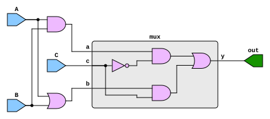
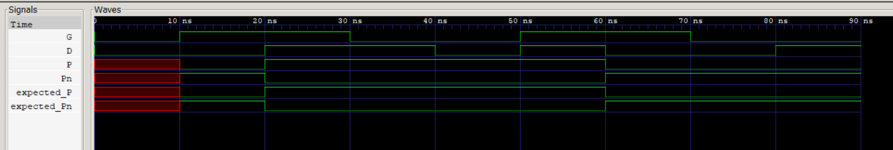

# Hardware Design Labs Practice

## Lab 1
### Practice 1
| 
Diagram
 |
| --- |
|  |

| 
Waveform
 |
| --- |
| 
gtkwave
 |
|  |
|  |

### Pracitce 2
| 
Diagram
 |
| --- |
|  |

| 
Waveform
 |
| --- |
| 
gtkwave
 |
|  |
