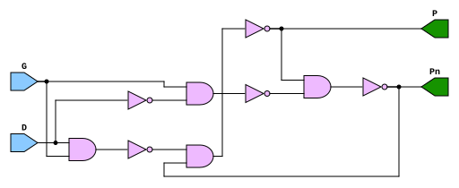
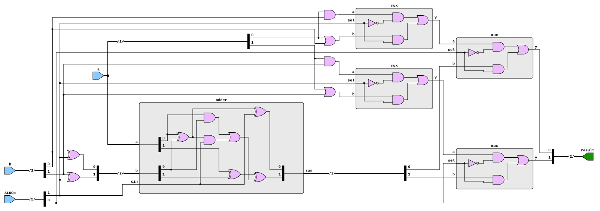
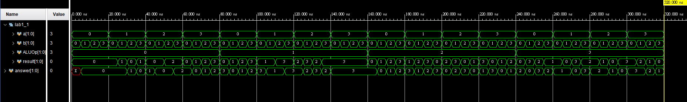
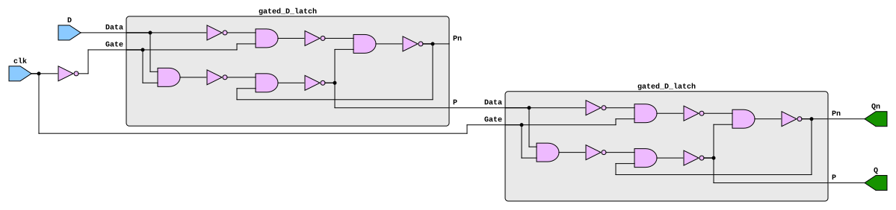
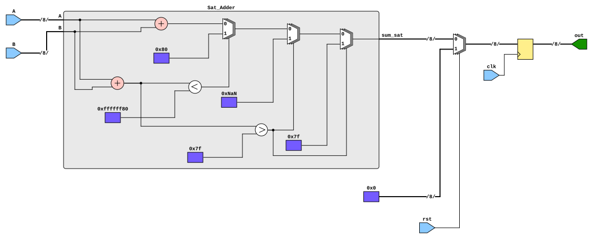
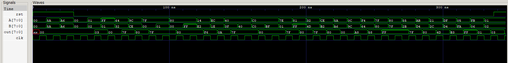

# Hardware Design Labs Practice

## Lab0: FPGA Board Test
| 
Waveform
 |
| --- |
|  |

## Lab1: Practices
### Practice 1
| 
Diagram
 |
| --- |
|  |

| 
Waveform
 |
| --- |
| 
gtkwave
 |
|  |
|  |
| 
Vivado
 |
|  |

### Pracitce 2
| 
Diagram
 |
| --- |
|  |

| 
Waveform
 |
| --- |
| 
gtkwave
 |
|  |
| 
Vivado
 |
|  |

## Lab1: Lab
### Part 1
| 
Diagram
 |
| --- |
| 
Straight from lab (50/64)
 |
|  |
| 
Corrected the index of MSB and LSB (64/64)
 |
|  |

| 
Waveform
 |
| --- |
| 
Straight from lab (50/64)
 |
|  |
| 
Corrected the index of MSB and LSB (64/64)
 |
|  |

### Part 2
| 
Diagram
 |
| --- |
|  |

| 
Waveform
 |
| --- |
|  |

## Lab2: Practice
### Part 1
| 
Diagram
 |
| --- |
|  |
|  |

| 
Waveform
 |
| --- |
| 
gtkwave
 |
|  |
| 
Vivado
 |
|  |

### Part 2
