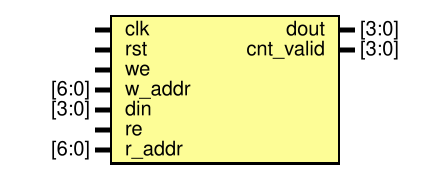

# Entity: lab5_practice 
- **File**: lab5_practice.sv

## Diagram

## Ports

| Port name | Direction | Type  | Description |
| --------- | --------- | ----- | ----------- |
| clk       | input     |       |             |
| rst       | input     |       |             |
| we        | input     |       |             |
| w_addr    | input     | [6:0] |             |
| din       | input     | [3:0] |             |
| re        | input     |       |             |
| r_addr    | input     | [6:0] |             |
| dout      | output    | [3:0] |             |
| cnt_valid | output    | [3:0] |             |

## Signals

| Name          | Type        | Description |
| ------------- | ----------- | ----------- |
| memory [0:7]  | logic [3:0] |             |
| valid [0:7]   | logic       |             |
| mapped_addr   | logic [2:0] |             |
| mapped_w_addr | logic [2:0] |             |
| mapped_r_addr | logic [2:0] |             |

## Functions
- calc_map_addr (input logic [6:0] addr) return (logic [2:0])

## Processes
- unnamed: (  )
  - **Type:** always_comb
- unnamed: (  )
  - **Type:** always_comb
- unnamed: ( @(posedge clk or posedge rst) )
  - **Type:** always_ff
